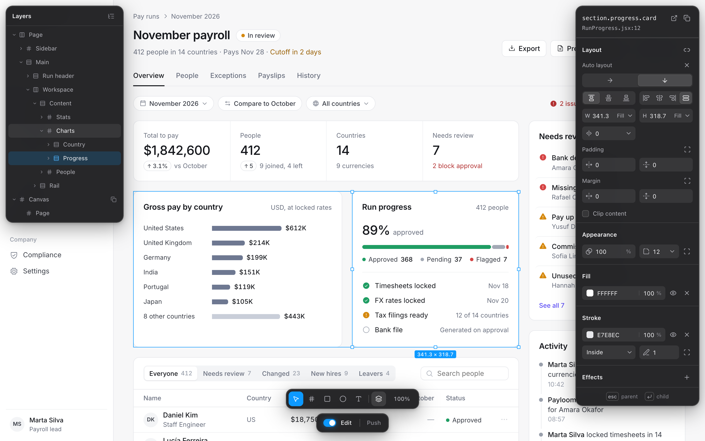

# Edit Mode

**Design on your real, running product the way you would in Figma, and let Claude Code turn what you changed into code.**



<!-- Demo video: [link] -->

Designers work in Figma, but people use the product, which is code. Every handoff loses something: a spacing value, a font weight, a layout that comes back almost right. Edit Mode removes the handoff. Turn it on in the browser and your running React app becomes a Figma-style canvas: Layers, auto layout, constraints and the same shortcuts. What you select is the real screen, with real data.

- **Tweak the live page.** Change padding, size, colour or text right where they are.
- **Rework on the canvas.** Duplicate the page onto a canvas beside it. Every piece of the copy remembers the line of code it came from, so you can restructure freely and still get exact edits back.
- **Design something new.** Frames, auto layout and text, with real components pasted in from the page.
- **Push.** Edit Mode compares your design with the code, lists exactly what changed, and has Claude Code rewrite your source with your project's own components and tokens. **Undo** puts the files back.

It runs only on the dev server; nothing ships in `vite build`.

## Try it

You need [Node.js](https://nodejs.org) 18 or newer. Push also needs [Claude Code](https://claude.com/claude-code) installed and logged in; everything else works without it.

```sh
git clone https://github.com/acdchung/edit-mode.git
cd edit-mode
npm install               # Edit Mode itself
cd console-app
npm install               # the demo app
npm run dev
```

Open http://localhost:5291 and press **⌥E** (Option-E). Then try this:

1. Click a name in the people table, choose **All like this** in the panel and change **H**.
2. In Layers, find the **Canvas** row and click its copy button (**Duplicate page**). Move or restyle something on the copy.
3. Press **Push** to see the list of changes. **Proceed** runs Claude Code on the demo app's files, and **Undo** in the pill restores them.

The repo has three example apps, all fictional: `console-app/` (a payroll review screen, the main demo), `demo-app/` (a landing page) and `sample-app/` (a small test bed).

## Add it to your own project

For a React + Vite project that uses plain CSS:

```sh
npm install --save-dev /path/to/edit-mode
```

```js
// vite.config.js
import editMode from 'edit-mode';

export default defineConfig({
  plugins: [editMode(), react()],
});
```

Run `npm run dev` as usual. Add an `EDITMODE.md` with your team's conventions (see below), or let the Push dialog draft one.

## How it was built

I designed and built Edit Mode on my own, with Claude Code as my engineering partner. I made the product calls; Claude wrote the code and the browser tests. The working files are here too:

- `DESIGN.md`: my design rules for the tool, with my original words kept as comments
- `ROADMAP.md`: the plan, what was decided and why, and what each real Push taught us
- `CLAUDE.md`: the notes each Claude Code session starts from (architecture, testing rules, gotchas)
- `tests/`: the browser tests (Playwright), including pixel comparisons and replays of real Pushes

## Use

| Key / action | What it does |
| --- | --- |
| Pill switch, or ⌥E | Edit mode on/off |
| Click | Select the outermost layer at the current level, like Figma: top-level sections first, then siblings of whatever is selected. Clicking inside the selection keeps it |
| Double-click | Go one level deeper. On selected text, edit it |
| ⌘-click | Select the deepest element directly (hold ⌘ to preview it on hover) |
| Esc / Enter | Select parent / first child (Enter on text starts editing it). Esc past the top level deselects |
| ⌫ / Delete | Delete element |
| Arrows / Shift + arrows | Nudge 1px / 10px (margin); inside auto layout, move earlier/later. With several selected, all of them (as a block in auto layout) |
| ⌘Z / ⌘⇧Z | Undo / redo |
| ⌘↵ | Push |
| Drag an element | Reorder it inside the frame it's in, as Layers shows it (the drop line shows where). Letting go outside the frame moves nothing: moving into another frame changes structure, so it happens on the canvas. With several selected from the same frame, drag any of them to move them all, in page order. Push applies the move as you saw it ("Put Nav after Hero and before Logos") |
| V / F / R / O / T | Select, Frame (canvas only), Rectangle, Ellipse, Text tools (toolbar above the pill). Hold Shift while drawing for a square or circle |
| Shift-click | Add to / remove from the selection, at the same depth as what's selected (title selected → Shift-click another card's title adds that title). Holding Shift previews it. ⇧⌘-click adds exactly the deepest element |
| Tab / Shift-Tab | Next / previous sibling |
| ⌘A | Select all siblings |
| Hold ⌥ | Measure distances to the hovered element (or to the parent) |
| ⌥A / ⌥H / ⌥D · ⌥W / ⌥V / ⌥S | On the canvas: align left / horizontal centers / right · top / vertical centers / bottom (also the two groups at the top of the panel: horizontal, vertical). One thing aligns to its frame; several align to each other. Not for things inside auto layout (greyed out, with the reason) |
| ⌃⌥H / ⌃⌥V | On the canvas: distribute horizontal / vertical spacing (three or more: equal gaps, the outer two stay put) |
| ⌥-drag | Duplicate and move the copy (or copies) |
| ⌥1, or the Layers button in the toolbar | Show / hide the Layers panel |
| ⌘+ / ⌘− / ⌘0 | Zoom in / out / to 100% (or use the % menu in the toolbar) |
| ⇧1 / ⇧2 / ⇧0 | Zoom to fit the page between the panels / to the selection / to 100% |
| Scroll, Shift-scroll | Pan the page (inside a scrollable box, scrolls that box) |
| ⌘-scroll or pinch | Zoom around the pointer |
| Space-drag, or middle-drag | Pan |
| ⌘\ | Hide / show the Edit Mode UI |
| ⌘C / ⌘V / ⌘X | Copy, paste (after the selection, or into an empty box you added), cut |
| ⌘D | Duplicate |
| ⌃ (hold while dragging) | Place or resize freely: no snapping. Otherwise moves on the canvas and resizes snap their edges and centre to what's around (siblings, frames, other canvas items, the live page) and a size snaps to another's (a page frame as tall as the page), with red guides (Figma's smart guides). Moves also snap to **equal spacing** (centred between two neighbours, or the same gap the row or column already has), shown as gap markers with the value. Drawing a shape or frame on the canvas snaps where you start and the corner you drag |
| ⌘G | Group the selection. On the canvas: a group the size of what's inside, and nothing moves (things stacked in a copied component stay stacked: the group joins their flow) |
| ⇧⌘G | Ungroup (canvas): what was inside takes the group's place, staying where it is |
| ⌘] / ⌘[ | Bring forward / send backward one step (inside auto layout: later / earlier in the flow) |
| ⌥⌘] / ⌥⌘[ | Bring to front / send to back |
| ⌥⇧A | Remove auto layout. On the canvas everything inside stays where it is, now placed freely, and the frame keeps its size |
| ⇧A | Auto layout: wraps a multi-selection or a single text/shape in a hugging frame (rows that filled their parent's width keep filling it); turns a container into auto layout |
| Drag a handle | Resize (hold Shift to keep proportions). With several selected, the handles are on the frame around all of them, and each element's size scales by the same amount |
| In a field: type, ↑/↓, or drag its label | Change a value (accepts %, and math like `8*2`) |

**Panel:** Layout (size, gap, padding, margin, and **Clip content** for anything that holds content: hides what sticks out past its edges; canvas frames start clipped, as in Figma). Sizing menus only offer what works: Hug is greyed out, with the reason, when nothing inside takes up space, and Fill when the element is placed by position. Appearance (opacity, roundness), Text, Fill, Stroke (inside = border, outside = outline; the sides button next to the weight picks All, one side, or Custom with a weight per side), Effects (shadow). Line height shows the way the code writes it (a multiplier like 1.35, Auto, or pixels). **Fill** has Figma's types: **Solid, Linear, Radial, Angular and Image**. To turn a solid fill into a gradient or an image, click its swatch and pick a type at the top of the color menu; a gradient or image fill switches type from its own menu (the first button in its row). A new gradient starts as the fill's color fading out, top to bottom. Gradients show a bar with a handle per stop: drag a handle to move its stop, click the bar to add one (in the color between its neighbours), select a handle and press Delete to remove it (a gradient keeps at least two), or nudge it with ←/→ (Shift: 10%). Each stop also has its own row: position (%), color and opacity, and ×. Linear and Angular have an angle field. **Image** asks for a file from your computer and fills the element with it: **Fill** (covers it, cropping the edges), **Fit** (the whole image, letterboxed) or **Tile** (repeats at its own size). Picking Image again replaces the image. This works on the live page and on the canvas. Empty fill/stroke/effects show as **+**. Colors, sizes and CSS variables already on the page are offered as quick picks.

**Several selected:** the panel shows Group / Auto layout / Delete, then the properties they share. Text, Gap and Auto layout show when every selected element has them; Fill, Stroke and Effects when any of them does. A field reads **Mixed** when the values differ. Typing a value sets it on all of them; ↑/↓ or dragging the label on a Mixed field shifts each one's own value by the same amount. Every edit is one ⌘Z.

**Layers panel (left):** the page's element tree, top to bottom in page order. Click a row to select, ⌘-click to add or remove, Shift-click for a range. Hovering a row highlights the element on the page, and the tree opens to whatever you select on the canvas. Drag rows to reorder them among their siblings (just below an open frame's row is its first spot). The arrow opens or closes a row (⌥-click opens everything inside). On hover, each row shows **eye** (hide: a change that Push applies as CSS) and **lock** (can't be clicked on the page; only for this session, not pushed). The top row is the **Page**. Layers are named the way a designer would (`nav-links` shows as "Nav links"; the code isn't changed). Wrappers you can't see are skipped, here and on the canvas: a plain wrapper around a single thing, `display: contents`, and `<main>`, the page's content area. So the page reads like a Figma file (Nav, Hero, Logos side by side under Page). The **Show all layers** button in the panel's header shows the code's own tree, wrappers included. Drag the panel's right edge to make it wider or narrower (double-click the edge to reset). Open or closed, and the width, are remembered.

**Canvas:** while editing, the page sits on a gray canvas like a Figma frame, and you can zoom and pan it so nothing is stuck under a panel. The page's own looping animations (a drifting background, a pulse) slow to a quarter speed while you edit. Sizes, fields and measurements always show real CSS pixels, whatever the zoom. Turning edit mode off puts the page back as it was. One limit: while editing, sticky and fixed headers scroll with the page.

**Width / height:** Fixed, Hug contents or Fill container (menu in the W and H fields), like Figma's resizing. Fill means the element follows its container (Edit Mode checks by growing the container for a moment); something stretched to its grid cell is Fill too. The **link** button in the Layout title row constrains proportions: setting W also sets H (and the reverse), and resize handles keep the ratio. While it's on, the W and H fields are outlined and joined in blue. It's per element and only for this session, not pushed.

**Padding and gap on the canvas:** select an auto-layout frame and point at it. Small purple bars mark each padding side and each gap between children. Hover one to see its value; drag it to change it (Shift snaps to steps of 8, ⌥ changes the opposite padding side too). Click a gap to type a value in the Gap field. Hold ⌘ to click through the bars to what's underneath. A padding of 0 still has a thin strip you can drag open. Dragging an **Auto** gap turns it into a fixed one. Each drag is one ⌘Z.

**Gap:** a plain number field. Its menu has one choice, **Auto**, which pushes children to the ends of the frame (Figma's auto spacing); typing `auto` does the same.

**This one / All like this:** for repeated elements. Defaults to This one. "All like this" covers a *family*:
- every element rendered from the same line of code (a card rendered 3 times = 3)
- plus any copies you make of them with ⌘D, paste or ⌥-drag, including the elements inside those copies
- a shape or text you add is its own family, and its copies join it

Push styles a family through one shared CSS rule, so the copies match the originals once they're in the code.

**Push:** shows the list of changes; **Proceed** snapshots your source, runs Claude in the background to apply them, then reloads the page. Changes you made on canvas copies are listed too, under **From the canvas**: each copy is compared with the page (styles, text, reordering, moves into other containers, deletions, new groups and auto-layout frames, new things, things placed freely with their constraints), one checkbox per copy. A change to one of several repeated items (one card of three) has a **Just this one / All N** switch, and two copies changing the same thing differently are shown in red. Proceed sends them along with the page's changes (two ticked copies that conflict have to be sorted out first: untick one). **New designs** (anything on the canvas that isn't a copy of the page: an auto-layout frame, a frame, a group, even a lone text) are listed too: **Skip** (the default), **Place** (click where it goes on the live page: the blue line shows the spot before or after the card or section under the pointer; ⌘ goes down to the smallest element), with its **Width** as designed or filling the spot, or **Component** (its own component file, named after the layer). Claude builds it from its exact layers and styles, reusing anything you pasted from the page (your real button stays your real Button). Once placed and pushed, the design is linked to its new code: tweak it on the canvas and the next Push sends exact edits. After a Push, the copies are matched to the new code again, so anything Claude didn't apply is still listed next time, and nothing else is. **Undo** (in the pill afterwards) restores the files Claude changed and brings your edits back so you can adjust and push again.

**Canvas:** while Edit Mode is on, a design canvas sits on the board 160px to the right of your page (pan over, or ⇧1 to fit both). It has its own **Canvas** section in Layers. What's on it can be selected and edited like the page and undone with ⌘Z. Push lists what you changed on copies of the page, and things designed from scratch as **New designs** (see Push). It's saved in `.editmode/canvas.json`, so it survives reloads. The canvas is **freeform**: things stay exactly where you put them, and you build structure when you're ready. The **Frame tool (F)** draws white frames at the size you drag (a click makes 100 × 100), with no auto layout. Rectangle, Ellipse and Text draw into a frame or onto the canvas, right where you click. **Drag anything anywhere** (like Figma): let go over a frame and it goes inside it, staying where you see it (or, in an auto-layout frame, joining its flow where the blue line shows); let go over the empty canvas and it's top-level. Out of auto layout, it becomes freely placed and the frame closes up behind it. While you drag, it floats above everything, so a clipping frame can't hide it. Rectangles, ellipses, images and text don't take things inside them (the drop goes to their frame). Moved pieces keep their look (a copied heading dragged out of its card keeps its font and color). Several selected move together, keeping their arrangement. In Layers, drop a row on the middle of a frame's row to put it inside (the row lights up), or above/below a row to place it there. Each move is one ⌘Z. Arrows nudge anything placed freely (Shift: 10px). **X / Y** in Layout show and set where something placed freely sits in its frame (top-level: on the canvas). Inside an auto-layout frame, the **pin** in the Layout title row is Figma's *Ignore auto layout*: the item leaves the flow but stays where it is, and the others close up (click it again to put it back). **Constraints** (for anything placed freely inside a frame) say how it follows the frame when the frame is resized: Left, Right, Left and right (stretches), Center or Scale, and the same for Top/Bottom. Changing one never moves anything; resizing the frame shows it live. Moves, nudges, align, X/Y, W/H and the resize handles all keep the constraint (dragging a resize handle keeps the opposite edge put, like Figma). Layers lists things in page order, so something brought forward moves *down* the list. **⇧A** turns a frame (or a selection) into auto layout without anything moving: the current arrangement becomes the direction (row or column), the gap and the padding. Inside an auto-layout frame, things stack and reorder. Delete on the canvas really removes the item (⌘Z brings it back). The Frame tool doesn't work on the live page: structure lives on the canvas. A fresh canvas starts empty: the whole grey space beside the page is yours, and anything you put straight on it is one design for Push. **Duplicate page** (the button on an empty canvas, or the copy button on the Canvas row in Layers) puts an identical copy of the whole page beside it, structure kept. ⌘C something on the page, select a canvas frame and ⌘V: the copy lands in the same spot it has on the page (in an auto-layout frame, it joins the layout). With nothing on the canvas selected, ⌘V pastes where the pointer is. Copies look identical and remember which code they came from (the panel shows "copy of …"), so Push can compare them with the originals. They're visual only: buttons and links don't respond. **Images:** drag image files from Finder onto the canvas (into a frame, or loose on the canvas, centered where you drop them; several land side by side), or copy an image anywhere (a browser, Preview, a screenshot, a file in Finder) and ⌘V: it lands in the selected canvas frame, centered, or where the pointer is, otherwise to the right of everything on the canvas. Each becomes an **image layer** named after its file, at its own size (at most 1000px on its longest side), with an image fill you can change like any other. PNG, JPG, GIF, WebP, AVIF and SVG, up to 25 MB. Dropping on the live page adds nothing (use Fill › Image for something on the page). Images are kept in `.editmode/assets/`; when an image fill reaches Push, Edit Mode copies the file into the project's `public/images/` first (Undo removes it again).

**EDITMODE.md (your project's conventions):** a short file at the project root that tells Push how your team writes UI code: how styles are written (plain CSS, CSS modules, Tailwind…), where design tokens live, which layout and shared components to reuse, and what to avoid. Push reads it first, and it wins over Edit Mode's defaults. If a project doesn't have one, the Push dialog offers **Draft one**: Claude reads your codebase and writes only that file (anything else it touches is put back), for you to review and edit. Point `EDIT_MODE_CLAUDE` (or the plugin's `claudePath` option) at a different `claude` binary if needed.

While edit mode is on (and while Claude works), hot reload is paused so file saves can't wipe your edits.

## Docs

- `CLAUDE.md`: architecture, conventions and testing rules (for Claude sessions)
- `ROADMAP.md`: what's next, in order

## Files

- `src/plugin.js`: the Vite plugin (tagging, overlay injection, hot-reload pause, push/undo endpoints)
- `src/tag-source.js`: adds `data-src="file:line:col"` to every HTML-style JSX tag
- `src/runner.js`: writes the handoff batch, runs Claude, snapshots and undo
- `src/apply-edits.md`: the instructions Claude follows
- `src/overlay/`: the in-browser UI (Shadow DOM)
  - `main.js`: pill, dialogs, selection, keyboard, text editing
  - `panel.js`: Selection card and properties panel
  - `layers.js`: Layers panel
  - `canvas.js`: zoom and pan
  - `design.js`: the design canvas beside the page
  - `assets.js`: images (upload, file picker, image fill modes)
  - `changes.js`: every edit, with undo/redo
  - `tokens.js`: colors, sizes and variables used on the page
- `tests/`: Playwright QA scripts (run against a copy of sample-app on port 5390)
- `sample-app/`: test project (`cd sample-app && npm run dev`)

Handoff batches, the canvas and added images are written to `.editmode/` in your project (git-ignored automatically).
